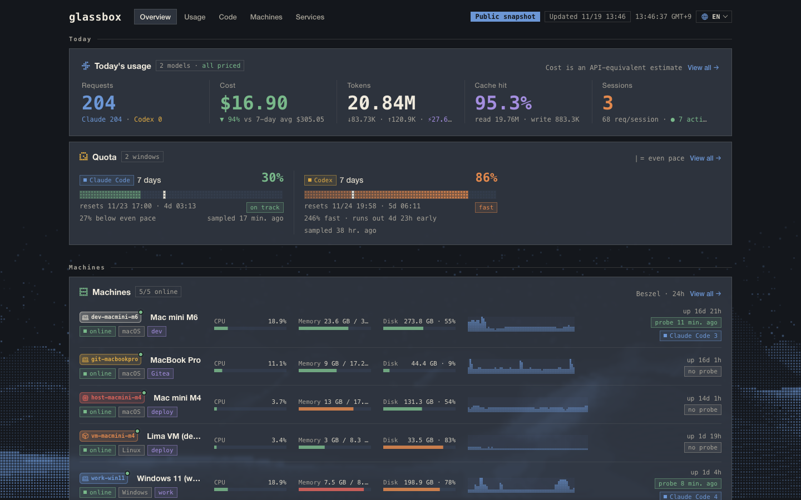
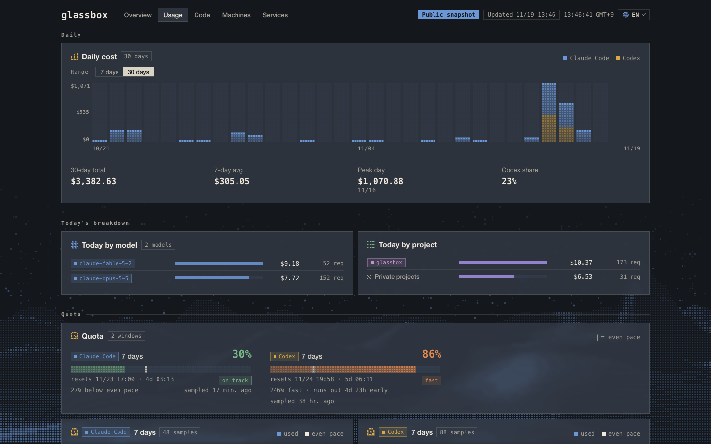
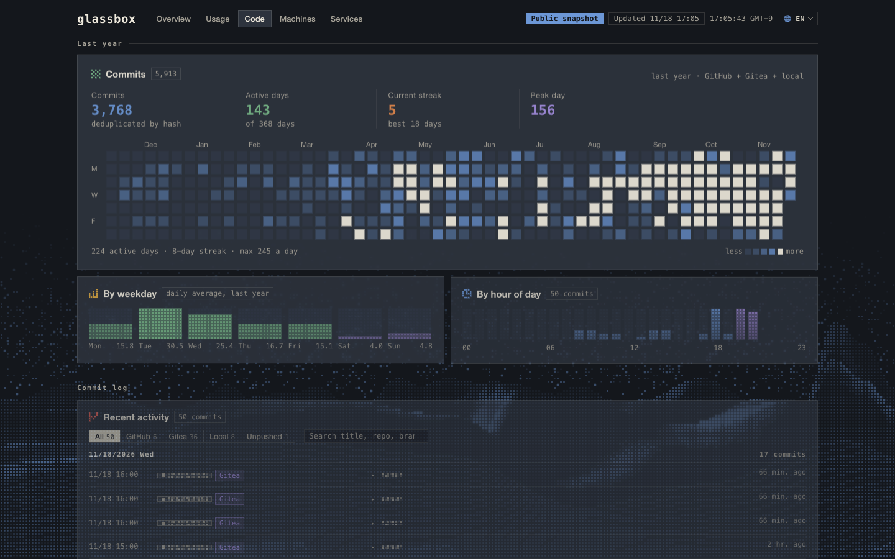
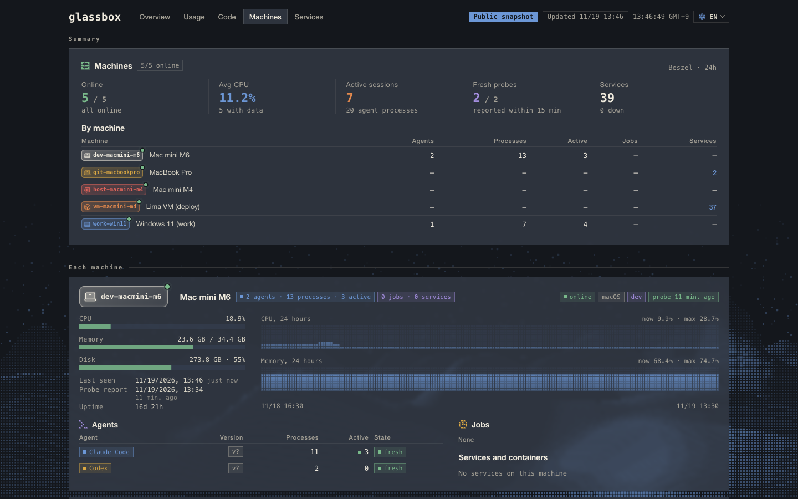
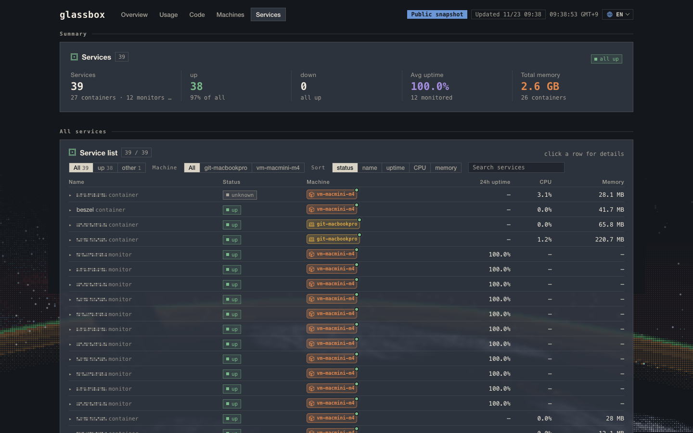

<div align="center">

# glassbox

**複数のコンピューターにまたがる AI 支援開発のための、セルフホスト型コックピット。**

Claude Code と Codex の使用量、クォータ、コード活動、マシンの状態を 1 ページに集約します。
tailnet 内ではすべてを見られるプライベートビュー、外部には無害化した公開スナップショットを提供します。

[**公開スナップショットを見る →**](https://status.bojiang.org)

[English](README.md) · [中文](README.zh.md) · 日本語



</div>

## 表示する内容

| | データ | ソース |
|---|---|---|
| **AI 使用量** | 日・時間・モデル・プロジェクト別のリクエスト数、トークン、キャッシュヒット、API 換算コスト | 各コンピューターの probe がローカルの Claude Code と Codex のログを読み取る |
| **クォータ** | Claude（7 日 / 5 時間）と Codex のウィンドウ：使用率、リセット時刻、ペース | Claude statusline のサンプル、Codex のログイベント |
| **Agent ランタイム** | マシンごとの CLI バージョン、実行中のプロセス、アクティブなセッション | Probe |
| **コード活動** | コントリビューションのヒートマップ、コミットログ、曜日別・時間帯別のリズム | GitHub API、Gitea API、ローカルの `git log` |
| **マシン** | CPU、メモリ、ディスク、稼働時間、オンライン状態、24 時間の履歴 | [Beszel](https://beszel.dev) agent |
| **サービス** | コンテナとモニターをサービスごとに統合し、稼働率を表示 | Uptime Kuma、読み取り専用の Docker API、`tailscale status` |

5 つのページ（Overview、Usage、Code、Machines、Services）があり、各パネルは展開できます。表示言語は English、中文、日本語です。

<table>
<tr>
<td></td>
<td></td>
</tr>
<tr>
<td></td>
<td></td>
</tr>
</table>

## 仕組み

```
 each computer                        deploy host (Docker, no published ports)
┌───────────────┐  HTTPS over tailnet ┌────────────────────────────────────────────┐
│ probe         │ ──────────────────► │ hub: /ingest → SQLite                       │
│ aggregates    │   one token each    │      collectors: GitHub · Gitea · Beszel ·  │
│ only, no text │                     │      Uptime Kuma · Docker · tailscale       │
└───────────────┘                     │      private view ◄── tailscale serve       │
                                      │ publisher: export → redact → gate → push    │
                                      │ tailscale sidecar · docker-socket-proxy     │
                                      └────────────────────────────────────────────┘
                                                          │ one-commit force push
                                         GitHub Pages + custom domain (public snapshot)
```

- **Probe**（`probe/`）：Python 3.12 の標準ライブラリのみで動作し、各コンピューターで 15 分ごとに実行されます（launchd または タスクスケジューラ）。送信するのは集計値だけで、プロンプト、コマンドライン、絶対パスは含まれません。
- **Hub**（`hub/`）：Tailscale sidecar の背後に置く 1 つのコンテナです。ホストのポートは公開せず、プライベートビューには tailnet 上の自分のデバイスからのみアクセスできます。
- **Publisher**（`hub/publish.py`）：定期的に（既定は 1 時間ごと、公開中のインスタンスは最短の 10 分ごと）フィールドのホワイトリストから公開ページを再構築し、push する予定のファイルそのものに対して公開ゲートを実行します。その後、親を持たない 1 つのコミットで `gh-pages` を置き換えるため、ブランチに古いスナップショットの履歴は残りません。
- **ページ**（`web/`）：フレームワークを使わない静的 HTML です。プライベートビューと公開ビューは、データだけが異なる同じページで、データは 1 つのファイルにインライン化されています。

## プライバシーモデル

プライベートビューはマスクせず、独自のログインもありません。tailnet の ACL で許可した自分のデバイスだけがアクセスできます。tailnet の外に出るものはすべて、互いに独立した 3 つの層を通ります。

1. **エクスポート**（`hub/export.py`）：公開ページは `schema/public_fields.json` から再構築します。プライベートなページを削って作ることはありません。プライベートなリポジトリ、プロジェクト、サービス、デバイスは、スタイルを適用する前に同じ長さのプレースホルダーに置き換えます。CSS のぼかしをプライバシーの境界として扱うことはありません。コミットタイトルからは、シークレット、メールアドレス、IP、パス、プライベートな名前をすべて取り除きます。
2. **公開ゲート**（`scripts/verify_public.py`）：独自のルールを持つ独立したチェッカーです。出力を実際のプライベートな名前と照合し、アドレス、キー、外部リソースをスキャンします。1 件でも検出すれば公開を拒否し、メッセージには値ではなく通し番号だけを表示します。`tests/redteam/` のレッドチームサンプルは、すべてブロックされなければなりません。
3. **リポジトリの衛生管理**：実データと環境の詳細は、git で無視される `.local/` にのみ置きます。pre-commit hook（`scripts/privacy_scan.py`。クローンごとに [`install-probe.md`](docs/runbooks/install-probe.md) の手順で導入し、自分の用語リストを用意します）は、プライベートな用語を含むコミットを拒否します。`web/` がステージされているときは、公開ゲート自身の照合器で公開されるページのコードも検査し（`scripts/check_web_terms.py`）、公開を止めてしまう変更をコミットの時点で止めます。

## 自分でデプロイする

| 手順 | ガイド |
|---|---|
| Docker ホスト上の Hub（Tailscale の背後） | [`deploy/README.md`](deploy/README.md)、[`docs/runbooks/deploy-hub.md`](docs/runbooks/deploy-hub.md) |
| 各コンピューターへの Tailscale | [`docs/runbooks/install-tailscale.md`](docs/runbooks/install-tailscale.md) |
| Probe とそのスケジュール | [`docs/runbooks/install-probe.md`](docs/runbooks/install-probe.md) |
| マシン統計用の Beszel agent | [`docs/runbooks/install-beszel-agent.md`](docs/runbooks/install-beszel-agent.md) |
| 公開スナップショットの設定 | [`docs/public.example.toml`](docs/public.example.toml) |
| Publisher（token、リポジトリ、ドメイン、間隔） | [`hub/publish.py`](hub/publish.py)（モジュールの docstring）、[`deploy/compose.yaml`](deploy/compose.yaml) |

必要なもの：Python 3.12（標準ライブラリのみ）、デプロイホストの Docker Compose、Tailscale アカウント。GitHub、Gitea、Beszel、Uptime Kuma は任意のデータソースです。

```sh
python3 -m probe --config ~/.glassbox/probe.toml push      # on each computer, after install-probe.md
docker exec glassbox glassbox-entrypoint collect all        # on the hub
python3 -m unittest discover -s tests                       # tests, no dependencies
```

## プロジェクト構成

```
probe/     per-machine collector (logs, quotas, git, runtimes)
hub/       ingest, collectors, page builder, exporter, publisher
web/       the page (HTML, CSS, JS; zh / ja / en)
schema/    data contract and the public field allowlist
scripts/   publish gate, privacy scan
deploy/    Dockerfile, compose, deploy guide
docs/      runbooks, screenshots, project plan and design notes
tests/     unit tests and red-team samples
```

## クレジット

[iamcheyan/svc-dashboard](https://github.com/iamcheyan/svc-dashboard) に着想を得ています。1 つのプライベートなダッシュボードと、GitHub Pages 上の無害化した公開スナップショットという発想です。glassbox は複数のコンピューター向けに書き直したもので、fork ではありません。

## ライセンス

[MIT](LICENSE)。背景の作品テンプレート 10-20 は [ascii.rest](https://github.com/bas3line/ascii)（MIT、© 2026 bas3line）を翻案したものです。詳しくは [THIRD_PARTY_NOTICES.md](THIRD_PARTY_NOTICES.md) を参照してください。
