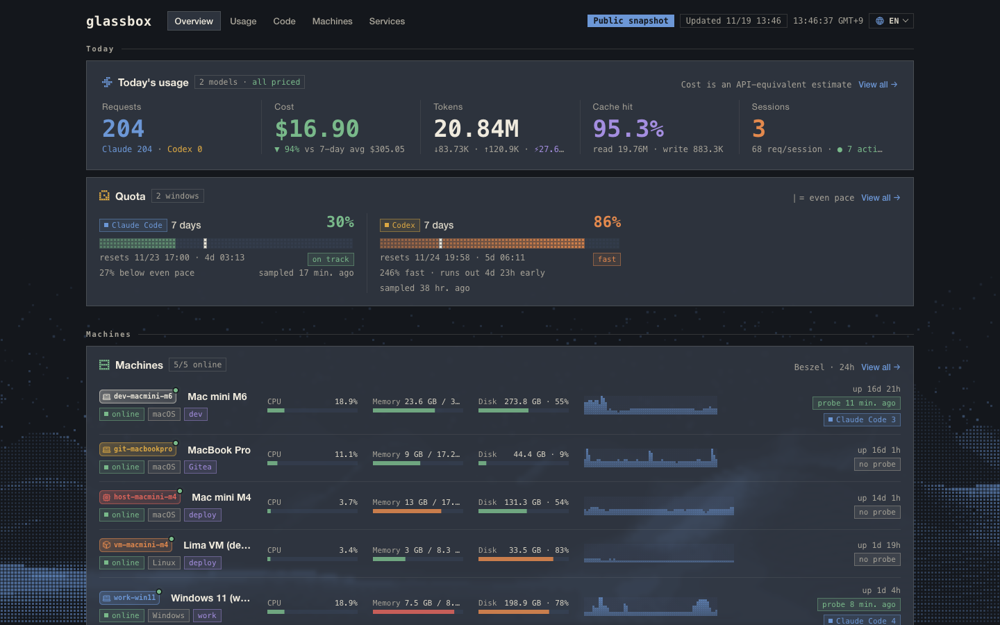
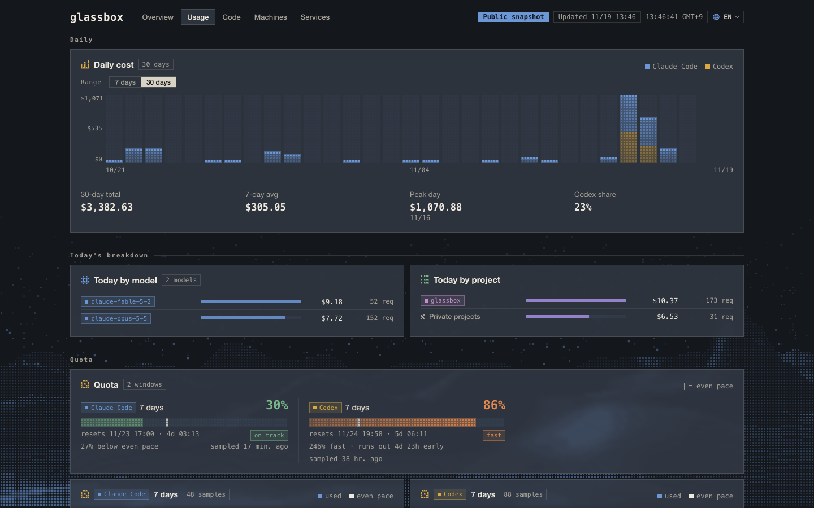
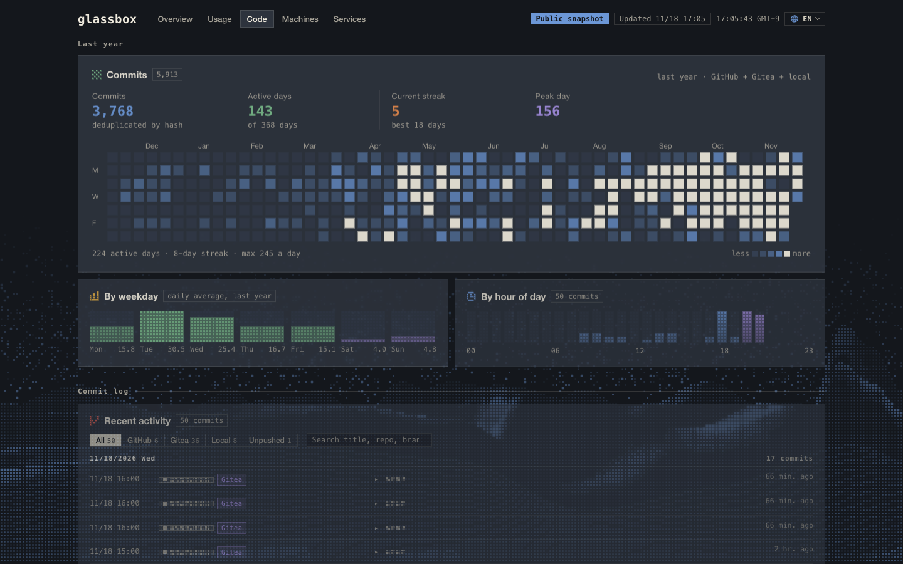
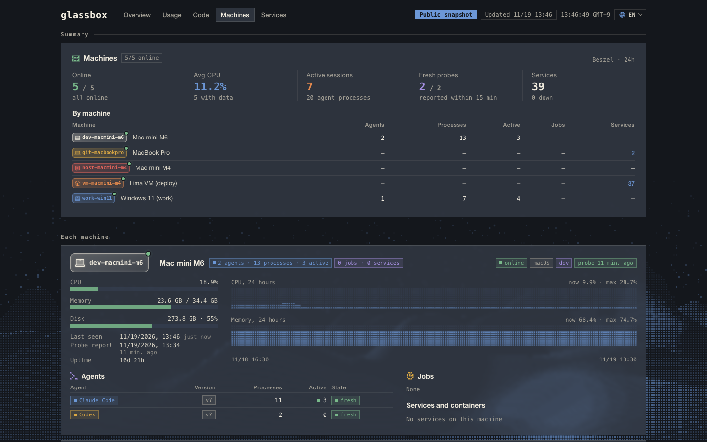
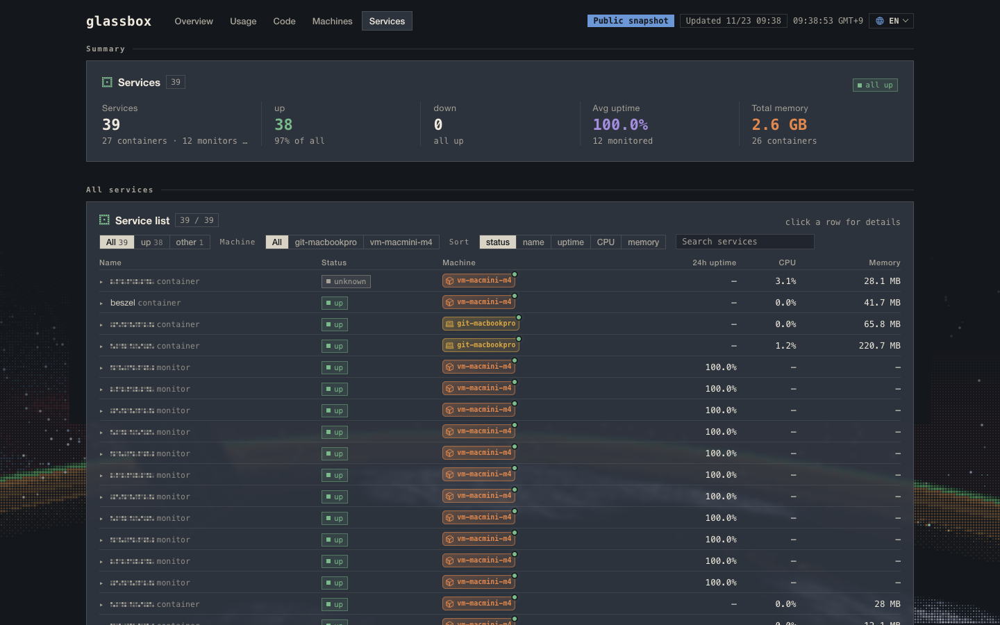

<div align="center">

# glassbox

**A self-hosted cockpit for AI-assisted development across several computers.**

Claude Code and Codex usage, quotas, code activity and machine health in one page:
a full private view inside your tailnet, and a sanitized public snapshot anyone can see.

[**Live public snapshot →**](https://status.bojiang.org)

English · [中文](README.zh.md) · [日本語](README.ja.md)



</div>

## What it shows

| | Data | Source |
|---|---|---|
| **AI usage** | Requests, tokens, cache hits and API-equivalent cost per day, hour, model and project | A probe on each computer reads the local Claude Code and Codex logs |
| **Quotas** | Claude (7 days / 5 hours) and Codex windows: used %, reset time, pace | Claude statusline samples, Codex log events |
| **Agent runtimes** | CLI versions, running processes, active sessions per machine | Probe |
| **Code activity** | Contribution heatmap, commit log, weekday and hour-of-day rhythm | GitHub API, Gitea API, local `git log` |
| **Machines** | CPU, memory, disk, uptime, online state, 24-hour history | [Beszel](https://beszel.dev) agents |
| **Services** | Containers and monitors, merged per service, with uptime | Uptime Kuma, a read-only Docker API, `tailscale status` |

Five pages (Overview, Usage, Code, Machines, Services), each panel expandable, in English, 中文 and 日本語.

<table>
<tr>
<td></td>
<td></td>
</tr>
<tr>
<td></td>
<td></td>
</tr>
</table>

## How it works

```
 each computer                        deploy host (Docker, no published ports)
┌───────────────┐  HTTPS over tailnet ┌────────────────────────────────────────────┐
│ probe         │ ──────────────────► │ hub: /ingest → SQLite                       │
│ aggregates    │   one token each    │      collectors: GitHub · Gitea · Beszel ·  │
│ only, no text │                     │      Uptime Kuma · Docker · tailscale       │
└───────────────┘                     │      private view ◄── tailscale serve       │
                                      │ publisher: export → redact → gate → push    │
                                      │ tailscale sidecar · docker-socket-proxy     │
                                      └────────────────────────────────────────────┘
                                                          │ one-commit force push
                                         GitHub Pages + custom domain (public snapshot)
```

- **Probe** (`probe/`): Python 3.12 standard library, runs every 15 minutes on each computer (launchd or Task Scheduler). It sends aggregate numbers only: no prompts, no command lines, no absolute paths.
- **Hub** (`hub/`): one container behind a Tailscale sidecar. It never publishes a host port; the private view is reachable only from your own devices on the tailnet.
- **Publisher** (`hub/publish.py`): on a schedule (hourly by default; the live site uses the 10-minute minimum) it rebuilds the public page from a field allowlist, runs the publish gate on exactly the files it is about to push, and replaces `gh-pages` with a single parentless commit, so the branch keeps no history of old snapshots.
- **Page** (`web/`): framework-free static HTML. The private and public views are the same page with different data, inlined into one file.

## Privacy model

The private view is not redacted and has no login of its own: only your devices, allowed by the tailnet ACL, can reach it. Everything that leaves the tailnet goes through three independent layers:

1. **Export** (`hub/export.py`): the public page is rebuilt from `schema/public_fields.json`, never trimmed from the private one. Private repositories, projects, services and devices become same-length placeholders before any styling; CSS blur is never treated as a privacy boundary. Commit titles lose secrets, e-mail addresses, IPs, paths and every private name.
2. **Publish gate** (`scripts/verify_public.py`): an independent checker with its own rules compares the output with the real private names, then scans for addresses, keys and outside resources. Any hit rejects the publish; its messages show ordinals, never the values. Red-team samples in `tests/redteam/` must all be blocked.
3. **Repository hygiene**: real data and environment details live only in a git-ignored `.local/`; a pre-commit hook (`scripts/privacy_scan.py`, installed per clone as in [`install-probe.md`](docs/runbooks/install-probe.md), with your own term list) rejects commits that contain private terms.

## Deploy your own

| Step | Guide |
|---|---|
| Hub on a Docker host, behind Tailscale | [`deploy/README.md`](deploy/README.md), [`docs/runbooks/deploy-hub.md`](docs/runbooks/deploy-hub.md) |
| Tailscale on each computer | [`docs/runbooks/install-tailscale.md`](docs/runbooks/install-tailscale.md) |
| Probe and its schedule | [`docs/runbooks/install-probe.md`](docs/runbooks/install-probe.md) |
| Beszel agent for machine stats | [`docs/runbooks/install-beszel-agent.md`](docs/runbooks/install-beszel-agent.md) |
| Public snapshot settings | [`docs/public.example.toml`](docs/public.example.toml) |
| Publisher (token, repo, domain, schedule) | [`hub/publish.py`](hub/publish.py) (module docstring), [`deploy/compose.yaml`](deploy/compose.yaml) |

Requirements: Python 3.12 (standard library only), Docker Compose on the deploy host, a Tailscale account. GitHub, Gitea, Beszel and Uptime Kuma are optional data sources.

```sh
python3 -m probe --config ~/.glassbox/probe.toml push      # on each computer, after install-probe.md
docker exec glassbox glassbox-entrypoint collect all        # on the hub
python3 -m unittest discover -s tests                       # tests, no dependencies
```

## Project layout

```
probe/     per-machine collector (logs, quotas, git, runtimes)
hub/       ingest, collectors, page builder, exporter, publisher
web/       the page (HTML, CSS, JS; zh / ja / en)
schema/    data contract and the public field allowlist
scripts/   publish gate, privacy scan
deploy/    Dockerfile, compose, deploy guide
docs/      runbooks, screenshots, project plan and design notes
tests/     unit tests and red-team samples
```

## Credits

Inspired by [iamcheyan/svc-dashboard](https://github.com/iamcheyan/svc-dashboard): the idea of one private dashboard plus a sanitized public snapshot on GitHub Pages. glassbox is a rewrite for several computers, not a fork.

## License

[MIT](LICENSE). Background templates 10-20 are adapted from [ascii.rest](https://github.com/bas3line/ascii) (MIT, © 2026 bas3line); see [THIRD_PARTY_NOTICES.md](THIRD_PARTY_NOTICES.md).
