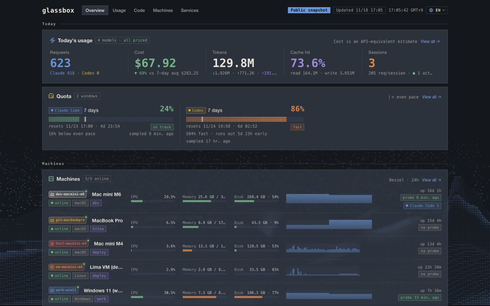
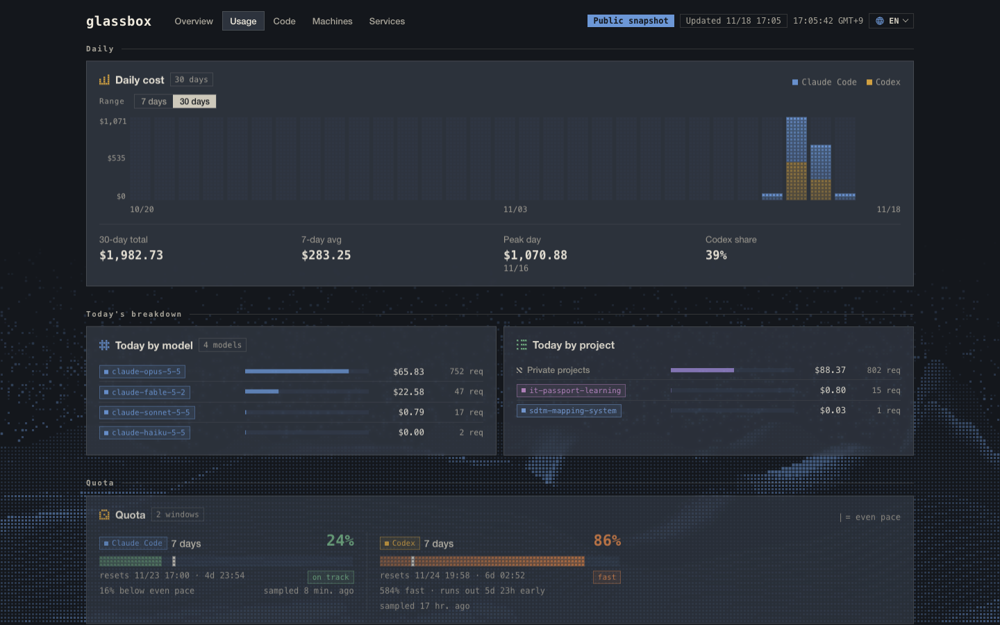
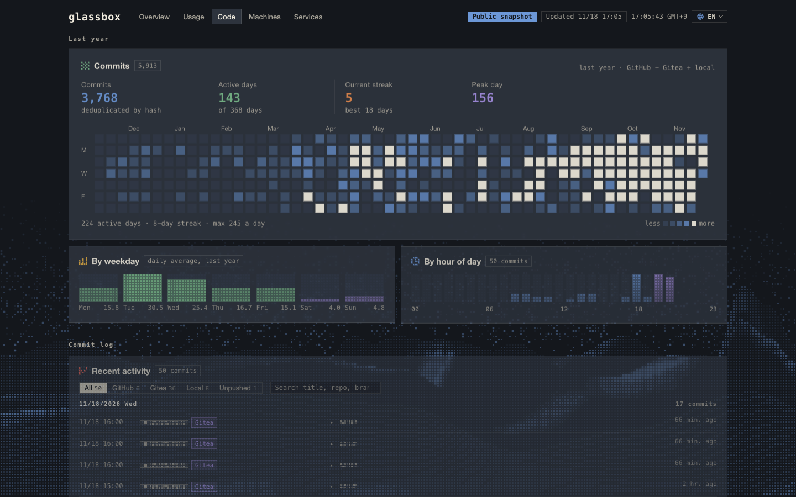
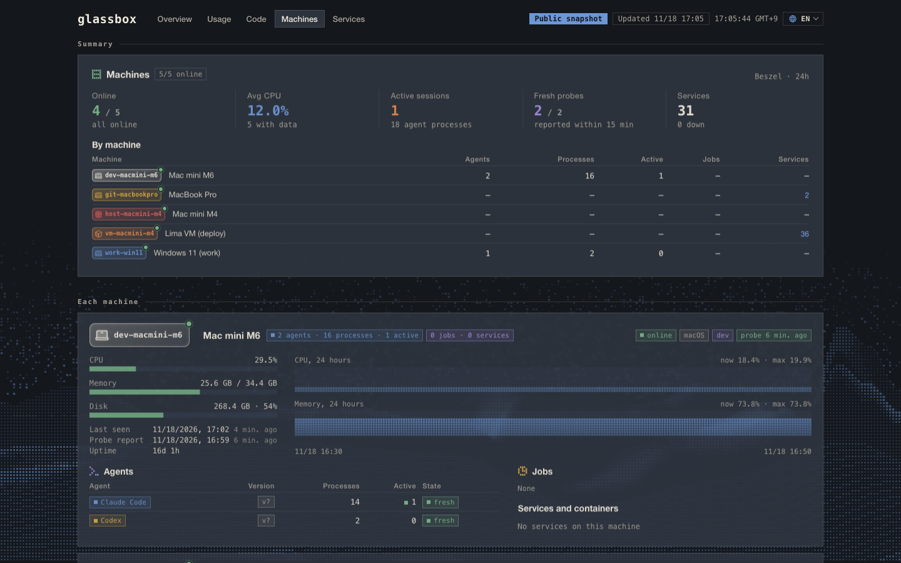
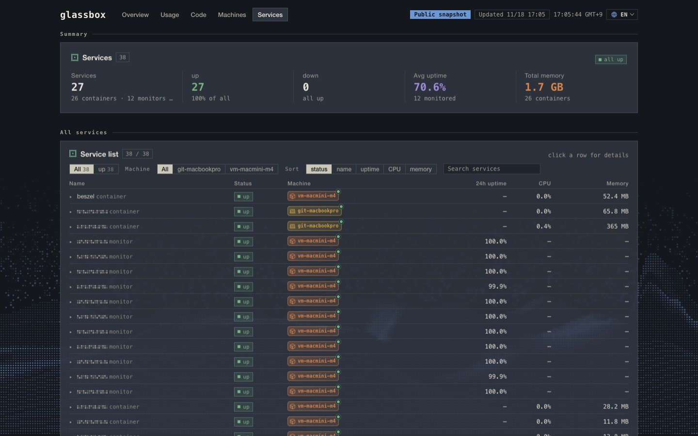

<div align="center">

# glassbox

**面向多台电脑 AI 辅助开发的自托管驾驶舱。**

Claude Code 和 Codex 的用量、额度、代码活动和机器健康状况汇总在一个页面里：
tailnet 内有完整的私有视图，另有一份脱敏的公开快照，任何人都能查看。

[**公开快照在线查看 →**](https://status.bojiang.org)

[English](README.md) · 中文 · [日本語](README.ja.md)



</div>

## 展示内容

| | 数据 | 来源 |
|---|---|---|
| **AI 用量** | 按天、小时、模型和项目统计请求数、token、缓存命中和等价 API 费用 | 每台电脑上的 probe 读取本地 Claude Code 和 Codex 日志 |
| **额度** | Claude（7 天 / 5 小时）与 Codex 窗口：已用百分比、重置时间、消耗节奏 | Claude statusline 采样、Codex 日志事件 |
| **Agent 运行时** | 各机器上的 CLI 版本、运行中的进程、活跃会话 | Probe |
| **代码活动** | 贡献热力图、提交记录、按星期和按小时的节奏 | GitHub API、Gitea API、本地 `git log` |
| **机器** | CPU、内存、磁盘、运行时间、在线状态、24 小时历史 | [Beszel](https://beszel.dev) agent |
| **服务** | 容器与监控项按服务合并，附带可用率 | Uptime Kuma、只读 Docker API、`tailscale status` |

共五个页面（Overview、Usage、Code、Machines、Services），每个面板都可展开，支持 English、中文和日本語。

<table>
<tr>
<td></td>
<td></td>
</tr>
<tr>
<td></td>
<td></td>
</tr>
</table>

## 工作原理

```
 each computer                        deploy host (Docker, no published ports)
┌───────────────┐  HTTPS over tailnet ┌────────────────────────────────────────────┐
│ probe         │ ──────────────────► │ hub: /ingest → SQLite                       │
│ aggregates    │   one token each    │      collectors: GitHub · Gitea · Beszel ·  │
│ only, no text │                     │      Uptime Kuma · Docker · tailscale       │
└───────────────┘                     │      private view ◄── tailscale serve       │
                                      │ publisher: export → redact → gate → push    │
                                      │ tailscale sidecar · docker-socket-proxy     │
                                      └────────────────────────────────────────────┘
                                                          │ one-commit force push
                                         GitHub Pages + custom domain (public snapshot)
```

- **Probe**（`probe/`）：仅使用 Python 3.12 标准库，在每台电脑上每 15 分钟运行一次（launchd 或 Task Scheduler）。只发送聚合数字：不含提示词、命令行和绝对路径。
- **Hub**（`hub/`）：一个容器，挂在 Tailscale sidecar 之后。它从不发布主机端口，私有视图只能从 tailnet 内你自己的设备访问。
- **Publisher**（`hub/publish.py`）：定时（默认每小时；线上实例用最短的 10 分钟）按字段白名单重新生成公开页面，对即将推送的文件运行发布门禁，然后用一个没有父提交的单一提交替换 `gh-pages`，因此该分支不保留旧快照的历史。
- **页面**（`web/`）：不依赖框架的静态 HTML。私有和公开视图是同一个页面，只是数据不同，数据内联在一个文件中。

## 隐私模型

私有视图不做脱敏，也没有单独的登录：只有 tailnet ACL 允许的你自己的设备能访问。所有离开 tailnet 的内容都要经过三层相互独立的防护：

1. **导出**（`hub/export.py`）：公开页面依据 `schema/public_fields.json` 重新生成，绝不是从私有页面裁剪而来。私有仓库、项目、服务和设备在应用任何样式之前，就已替换为等长的占位符；CSS 模糊从不被视为隐私边界。提交标题会去掉密钥、邮箱地址、IP、路径和所有私有名称。
2. **发布门禁**（`scripts/verify_public.py`）：一个使用独立规则的检查器，先把输出与真实的私有名称比对，再扫描地址、密钥和外部资源。任何命中都会拒绝发布；其提示只显示序号，不显示具体值。`tests/redteam/` 中的红队样本必须全部被拦截。
3. **仓库卫生**：真实数据和环境细节只存放在被 git 忽略的 `.local/` 中；pre-commit hook（`scripts/privacy_scan.py`，每个克隆按 [`install-probe.md`](docs/runbooks/install-probe.md) 单独安装，并配上你自己的私有词表）会拒绝包含私有词汇的提交。

## 部署你自己的实例

| 步骤 | 指南 |
|---|---|
| 在 Docker 主机上部署 Hub，置于 Tailscale 之后 | [`deploy/README.md`](deploy/README.md)、[`docs/runbooks/deploy-hub.md`](docs/runbooks/deploy-hub.md) |
| 在每台电脑上安装 Tailscale | [`docs/runbooks/install-tailscale.md`](docs/runbooks/install-tailscale.md) |
| Probe 及其定时任务 | [`docs/runbooks/install-probe.md`](docs/runbooks/install-probe.md) |
| 用于机器指标的 Beszel agent | [`docs/runbooks/install-beszel-agent.md`](docs/runbooks/install-beszel-agent.md) |
| 公开快照设置 | [`docs/public.example.toml`](docs/public.example.toml) |
| 发布器（token、仓库、域名、频率） | [`hub/publish.py`](hub/publish.py)（模块文档字符串）、[`deploy/compose.yaml`](deploy/compose.yaml) |

环境要求：Python 3.12（仅标准库）、部署主机上的 Docker Compose、一个 Tailscale 账号。GitHub、Gitea、Beszel 和 Uptime Kuma 是可选的数据源。

```sh
python3 -m probe --config ~/.glassbox/probe.toml push      # on each computer, after install-probe.md
docker exec glassbox glassbox-entrypoint collect all        # on the hub
python3 -m unittest discover -s tests                       # tests, no dependencies
```

## 项目结构

```
probe/     per-machine collector (logs, quotas, git, runtimes)
hub/       ingest, collectors, page builder, exporter, publisher
web/       the page (HTML, CSS, JS; zh / ja / en)
schema/    data contract and the public field allowlist
scripts/   publish gate, privacy scan
deploy/    Dockerfile, compose, deploy guide
docs/      runbooks, screenshots, project plan and design notes
tests/     unit tests and red-team samples
```

## 致谢

灵感来自 [iamcheyan/svc-dashboard](https://github.com/iamcheyan/svc-dashboard)：一个私有仪表盘，加一份发布在 GitHub Pages 上的脱敏公开快照。glassbox 是面向多台电脑的重写版本，不是 fork。

## 许可证

[MIT](LICENSE)
